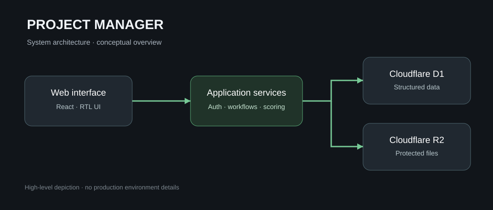

# NaarCode Project Manager

**An internal project operations system built around delivery, accountability, and quality control.**

[فارسی](README.fa.md) · [Architecture](docs/ARCHITECTURE.md) · [Security notes](docs/SECURITY.md)

NaarCode Project Manager brings project planning, execution tracking, quality checklists, and operational activity into one workspace. It was developed to support the day-to-day delivery of digital products, where task status alone is not enough to understand progress or release readiness.

> **Repository scope:** This is a product and engineering showcase, not the application's source distribution. Operational code, user data, and infrastructure credentials are intentionally excluded. The diagrams describe the system's design; they are not product screenshots.

## The problem

Running multiple software projects requires consistent delivery checks, clear ownership, and a traceable record of decisions. When these live in separate tools and documents, quality control becomes harder to maintain between projects and releases.

The application organizes these concerns around a shared project model while allowing checklists to adapt to project type and enabled modules.

## Implemented capabilities

- Project and team management with **administrator, project manager, and member** roles
- A five-step project creation flow with project-specific module selection
- Checklist composition using **Core + Project Type + Modules → Project Snapshot**
- A library of 435 checklist entries and an independent checklist snapshot per project
- Server-side progress and weighted quality scoring
- Milestones, notes, activity history, notifications, and protected file handling
- Role- and membership-based access enforcement
- Responsive Persian right-to-left interface

## Design decision: stable project snapshots

Checklist definitions are copied into a project-specific snapshot when a project is created. Subsequent changes to the shared template library do not silently rewrite an existing project's acceptance criteria.

Progress counts completed items against applicable items, excluding those marked not applicable. Quality scores are calculated with weights on the server. Authorization and validation rules are also enforced on the server rather than relying on UI visibility.

## Technology

`TypeScript` · `Next.js` · `React` · `Cloudflare Workers` · `Cloudflare D1` · `Cloudflare R2` · `Drizzle ORM`

## Architecture

See [Architecture](docs/ARCHITECTURE.md) for the system boundaries and workflow decisions.

## Availability

This repository is a **portfolio presentation**, not a deployable version of the product. It contains no production database, private configuration, authentication implementation, or application business logic.

## Rights and usage

© NaarCode. All rights reserved. No open-source license is granted for the contents of this repository. Reuse or redistribution beyond applicable legal exceptions requires prior written permission.

[NaarCode website](https://naarcode.com/fa)
